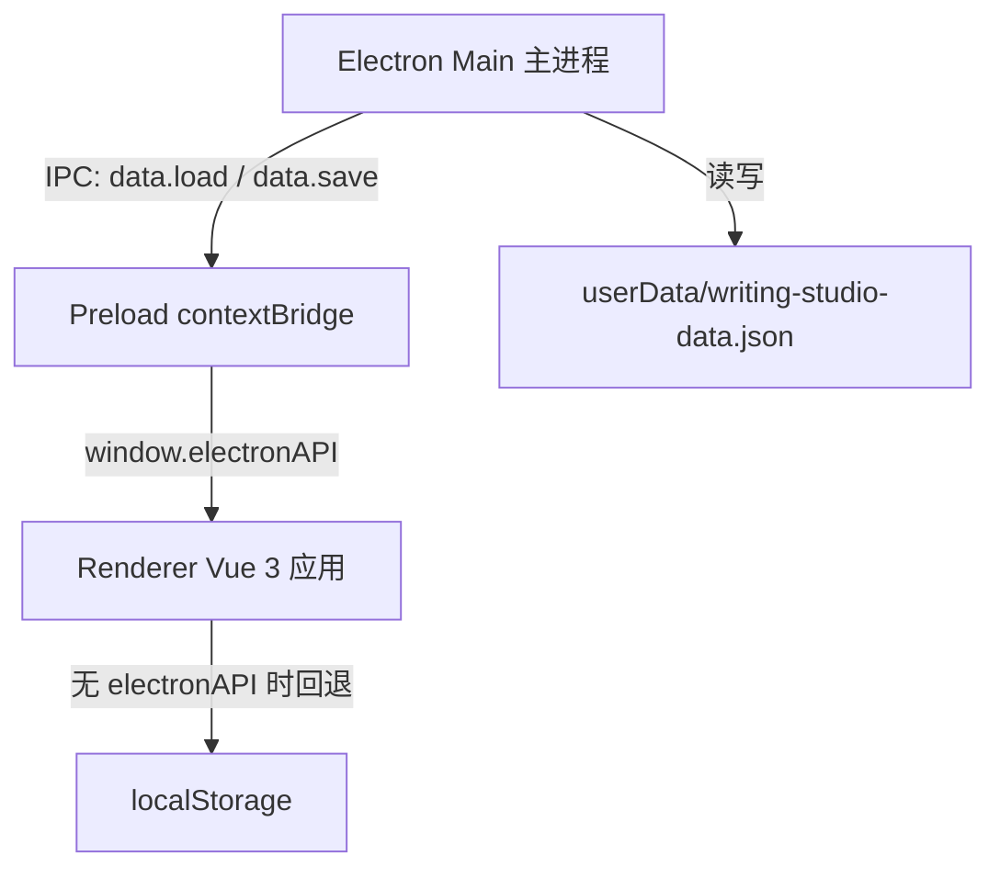

# Writing Studio 技术设计

Feature Name: writing-studio
Updated: 2026-10-22

## Description

面向 Windows 11 的本地写作软件。文章为母任务，文章下挂载独立文档、人物关系、时间轴三类子项目，三种子项目以竖排列并排呈现。时间轴支持乱序录入文段、拖拽排序、时间文本可空/事件文本必填、文段与独立文档及人物关系（含单个人物）建立关联。数据全部本地持久化。

## Architecture



- 主进程：创建窗口，通过 IPC 提供基于 JSON 文件的数据读写（userData 目录）。
- Preload：contextBridge 暴露 `electronAPI.loadData / saveData`，开启 contextIsolation。
- Renderer：Vue 3 单页应用。存储层抽象为 `storage.js`：检测到 `electronAPI` 时走 IPC，浏览器预览环境回退 localStorage。
- 打包：electron-builder 生成 Windows NSIS 安装包（在 Windows 机器上执行 `npm run electron:build`）。
- 开发：`npm run dev` 仅启动 Vite（浏览器预览）；`npm run electron:dev` 同时启动 Vite 与 Electron。

## Components and Interfaces

```
src/
├── main/main.js              # 窗口创建、IPC 数据读写
├── preload/preload.js        # contextBridge
└── renderer/
    ├── main.js               # Vue 入口
    ├── App.vue               # 视图切换：文章列表 / 工作区
    ├── store.js              # reactive 全局状态 + 全部业务 action
    ├── storage.js            # 存储抽象（IPC | localStorage）
    └── components/
        ├── ArticleList.vue   # 文章列表、新建/删除文章
        ├── WorkSpace.vue     # 文章工作区、三列布局、子项目创建、关联打开定位
        ├── DocPanel.vue      # 独立文档列
        ├── TimelinePanel.vue # 时间轴列（含拖拽排序）
        ├── TimelineSegment.vue # 单条文段：时间|事件、编辑、关联 chips
        ├── RelationsPanel.vue  # 人物关系 SVG 画布
        └── LinkPicker.vue    # 关联选择弹窗（文档 / 人物）
```

### WorkSpace 布局

- 顶栏：返回按钮、文章标题（可内联编辑）、正文折叠面板。
- 主体三列：独立文档列 | 人物关系列 | 时间轴列，各自内部条目竖排堆叠、独立滚动。
- 列头提供对应"新建"按钮。

### 时间轴拖拽排序（TimelinePanel）

- 文段卡片 `draggable`，`dragstart` 记录 sourceIndex。
- `dragover` 根据鼠标相对目标卡片中点位置计算插入索引，显示高亮指示线。
- `drop` 时对 `segments` 数组做 splice 移动，持久化新顺序。
- 空时间轴支持直接放入。

### 人物关系 SVG 画布（RelationsPanel）

- 数据：`persons: [{id, name, note, x, y}]`，`edges: [{id, from, to, label}]`。
- 节点拖拽：mousedown 捕获，`getScreenCTM().inverse()` 将鼠标坐标转换为 SVG 坐标。
- 单击节点选中；已有选中时再点另一节点弹出建立关系（输入描述）。
- 双击节点重命名/编辑备注；单击边选中边，工具栏提供编辑描述、删除。
- 工具栏：添加人物、重命名选中、删除选中（人物或关系）。

### 关联模型（LinkPicker）

- 文段上的关联：
  - `docLinks: string[]` —— 独立文档 id 列表。
  - `personLinks: [{relationsId, personId|null}]` —— 人物关系子项目（可细化到单人）。
- 关联范围限定在同一文章内的子项目。
- chips 展示在文段底部，点击 chip 由 WorkSpace 定位并展开目标子项目（人物关联附带高亮该人物节点）。
- 删除被关联的文档/人物关系/人物时，级联清理全部指向它的关联。

## Data Models

```json
{
  "articles": [
    {
      "id": "uuid",
      "title": "文章标题",
      "content": "文章正文",
      "createdAt": 1730000000000,
      "children": [
        { "id": "uuid", "type": "doc", "title": "独立文档", "content": "" },
        {
          "id": "uuid", "type": "timeline", "title": "时间轴",
          "segments": [
            {
              "id": "uuid", "time": "第三年春", "event": "事件文本",
              "docLinks": ["docId"],
              "personLinks": [{ "relationsId": "rid", "personId": "pid|null" }]
            }
          ]
        },
        {
          "id": "uuid", "type": "relations", "title": "人物关系",
          "persons": [{ "id": "pid", "name": "人物名", "note": "", "x": 100, "y": 80 }],
          "edges": [{ "id": "eid", "from": "p1", "to": "p2", "label": "师徒" }]
        }
      ]
    }
  ]
}
```

## Correctness Properties

1. 事件文本为空的文段保存被拒绝并提示；时间文本为空允许保存。
2. 拖拽 drop 后 segments 数组顺序与界面顺序一致，刷新后保持。
3. 任何变更后 300ms 内防抖持久化，重启应用数据完整恢复。
4. 删除文档/人物关系/人物后，所有指向该目标的关联 chip 消失，文段与其它内容无损。
5. 关联选择器只列出当前文章内的子项目。

## Error Handling

- 本地存储读取失败或 JSON 损坏：回退空数据并以 console.error 记录，界面提示数据加载异常。
- IPC 不存在（纯浏览器预览）：自动回退 localStorage。
- 删除文章/人物/关系/文档：confirm 二次确认。

## Test Strategy

- 手工验证清单覆盖全部 EARS 验收标准：文章增删改、三种子项目创建与竖排并列呈现、文段校验（事件必填/时间可空）、拖拽排序、三类关联建立/打开/移除、级联清理、刷新恢复。
- 构建验证：`npm run build` 通过；Electron 主/预加载脚本语法通过 node 校验。

## References

[^1]: (Filename) - 需求文档 .monkeycode/specs/writing-studio/requirements.md
