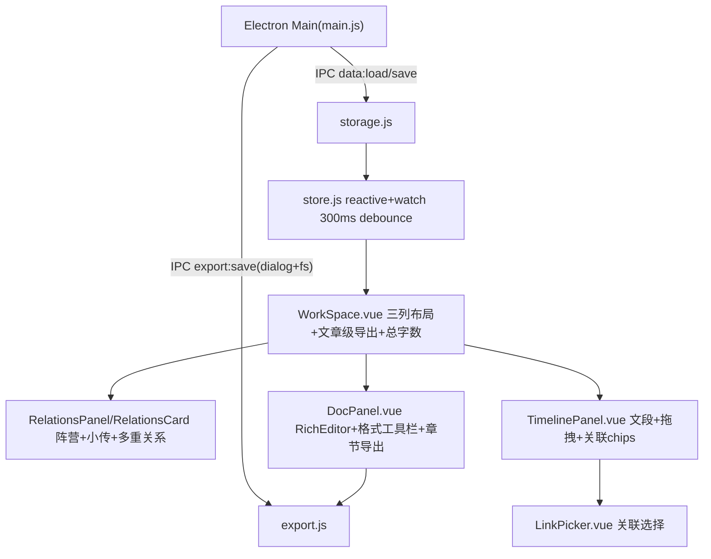

# Writing Studio

Feature Name: writing-studio
Version: 2.0
Updated: 2026-10-23

## Description

Win11 本地写作软件。文章（母任务）下挂载三类子项目：章节（原"独立文档"）、人物关系、时间轴。工作区三列并列（人物关系 | 章节 | 时间轴），支持最大化/最小化/自由调宽。章节为富文本窗口（回车缩进、字号统一设置，加粗/斜体作用于选区），支持独立字数统计与文章级总字数。导出：章节级 .docx/.md/.rtf/.png（全部或指定窗口）；文章级合并导出全部章节+人物关系+时间轴为单一 .rtf。人物关系支持阵营（颜色标识、描述）、人物小传（编辑/查看）、同一对人物多重关系并列曲线呈现。默认白色主题（#FFFFFF）。

## Architecture



- 渲染层为 Vue 3 (Vite)。浏览器预览无 electronAPI 时存储回退 localStorage、导出回退 Blob 下载。
- Electron 主进程新增 `export:save` IPC：`dialog.showSaveDialog` + `fs.writeFile`。

## Components and Interfaces

| 组件 | 职责 |
| --- | --- |
| store.js | 数据模型 normalize/迁移（v1 纯文本→富文本）、全部业务 action、字数统计 `countWords` |
| export.js | `htmlToPlain`、`buildMarkdown`、`buildRtf`（含 `rtfTable` 内置表格）、`buildDocx`(docx 库)、`buildPng`(canvas)、`buildRelationsSvg`/`buildTimelineSvg`(.svg)、`saveFile`(IPC 或下载) |
| RichEditor.vue | contenteditable 富文本编辑器；WHEN 回车缩进开启，keydown Enter → `insertParagraph` + `insertText` 两个全角空格 |
| WorkSpace.vue | 三列布局状态机（normal/max/min + 可拖分隔条）、大纲入口、总字数、文章级导出（勾选范围） |
| DocPanel.vue | 章节卡片、每窗口字数、格式工具栏（回车缩进/字号/加粗/斜体）、导出面板（范围+格式） |
| RelationsCard.vue | SVG 关系图：人物节点（阵营色环）、多重关系以 15px 线距并列错开（叠加 bend 偏移）、bend 手柄拖拽弯曲、关系描述沿线条方向旋转呈现（按线距堆叠防重叠）、阵营标签为拖放目标（人物卡片拖入入营/拖出离营）、导出 .svg |
| RelationsPanel.vue | 人物关系子项目卡片列表（标题/删除/折叠），内嵌 RelationsCard |
| TimelinePanel.vue | 时间轴子项目卡片列表：文段新建/编辑（时间可空、事件必填）、手柄拖拽排序、关联 chips、导出 .svg（竖向时间轴） |
| renderer/main.js | focusin 追踪最近文本窗口；F11 → 对当前 rich-editor/textarea 切换 requestFullscreen |

## Data Models

```js
article = {
  id, title, content, createdAt, updatedAt,
  docFormat: { indent: Boolean, fontSize: Number },  // v2 章节统一格式
  children: [child]
}
child(type='doc')      = { id, type:'doc', title, content /*HTML*/, rich:true }        // 章节窗口
child(type='timeline') = { id, type, title, segments:[{ id, time, event, docLinks[], personLinks[] }] }  // 可多个
child(type='relations')= {   // 可多个
  id, type, title,
  persons: [{ id, name, note, bio, factionId|null, x, y }],
  factions: [{ id, name, desc, color }],
  edges: [{ id, from, to, label, bend|null }]   // bend 为垂直于弦线方向的控制点偏移量
}
```

- v2 迁移：normalize 时对 `type==='doc'` 且无 `rich` 标记的章节，将纯文本按行转义为 `<p>` 段落 HTML 并置 `rich:true`（保留原文本，无信息丢失）。
- 加粗/斜体以内联 `<strong>/<em>` 存于 content HTML；回车缩进/字号为 article.docFormat 渲染层设置，进入导出样式。

## Correctness Properties

1. 任一时刻序列化 data → 重新加载 → normalize 输出与序列化前语义等价（迁移幂等）。
2. 删除章节/人物关系/人物/阵营后，时间轴关联与人物归属无悬挂引用。
3. 同一对人物的 n 条关系在画布上呈现 n 条几何可区分的连线。
4. 字数统计 = CJK 字符数 + 西文单词数（HTML 标签与空白不计入）。
5. 三列布局任意操作（max/min/拖宽）后至少一列可见且宽度总和恒等于容器宽。

## Error Handling

- 导出：docx/Pack 失败或 canvas 尺寸超限时提示错误并中止；Electron 保存对话框取消 → 返回 `{saved:false}` 静默结束。
- 数据加载失败沿用既有 loadError 空数据启动策略。
- 拖拽分隔条限定单列最小 260px，避免列宽归零。

## Test Strategy

- `npm run build` 编译通过（vite + vue SFC 编译检查）。
- main/preload 用 `node --check` 语法校验。
- 手动验收：白色主题、章节更名与字数、格式工具栏、四格式导出、文章级 rtf 合并导出、阵营/小传、多重关系并列、三列布局操作、数据迁移（旧纯文本章节打开后正常显示且再次加载不重复转换）。

## References

- [^1]: src/renderer/store.js — 数据模型与业务动作
- [^2]: src/renderer/export.js — 导出实现
- [^3]: src/main/main.js — Electron IPC（数据与导出保存）
- [^4]: src/renderer/components/WorkSpace.vue — 三列布局
